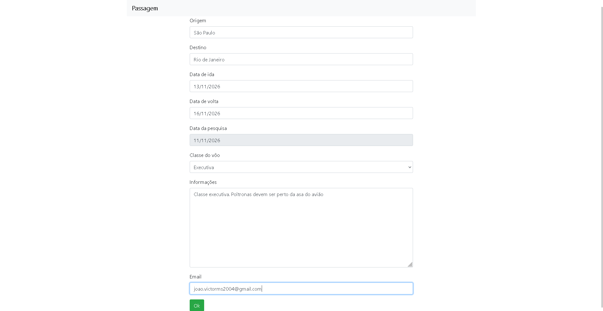

<h1 align="center" style="font-weight: bold;"> Cadastro de Passagens</h1>

<p align="center">
  
</p>

[PYTHON__BADGE]: https://img.shields.io/badge/Python-3776AB?style=for-the-badge&logo=python&logoColor=white
[DJANGO__BADGE]: https://img.shields.io/badge/Django-092E20?style=for-the-badge&logo=django&logoColor=white
[SQLITE__BADGE]: https://img.shields.io/badge/SQLite-003B57?style=for-the-badge&logo=sqlite&logoColor=white
[HTML__BADGE]: https://img.shields.io/badge/HTML5-E34F26?style=for-the-badge&logo=html5&logoColor=white

<p align="center">
  - <a href="#technologies">Tecnologias</a>
  - <a href="#started">Iniciando</a> •
  <a href="#features">Funcionalidades</a> •
  <a href="#colab">Colaboradores</a> •
  <a href="#contribute">Contribua</a>
</p>

<p align="center">
  <b>Aplicação web em Django focada em gerenciamento avançado de formulários, validações de regras de negócio customizadas e integração com componentes de UI modernos.</b>
</p>

<h2 id="layout">🎨 Layout/Preview</h2>

<p align="center">
  
  
</p>

<h2 id="technologies">💻 Tecnologias</h2>

<div>

![Python][PYTHON__BADGE]
![Django][DJANGO__BADGE]
![SQLite][SQLITE__BADGE]
![HTML5][HTML__BADGE]

</div>

<h2 id="started">🚀 Iniciando</h2>

Siga os passos abaixo para configurar e rodar o projeto em sua máquina local.

<h3>Pré-requisitos</h3>

- [Python 3.8+](https://www.python.org/)
- [Git](https://git-scm.com/)

<h3>Clonando</h3>

```bash
git clone https://github.com/JoaoxVictorMS/Passagens_Form.git
cd Passagens_Form
```

<h3>Configurando o Ambiente Virtual</h3>

Crie e ative o ambiente virtual para isolar as dependências do projeto:

```bash
# Criando o ambiente virtual
python -m venv .venv

# Ativando no Windows (PowerShell)
.\.venv\Scripts\Activate.ps1

# Ativando no Windows (Git Bash)
source .venv/Scripts/activate

# Ativando no Linux / macOS
source .venv/bin/activate
```

<h3>Instalando as Dependências</h3>

Com o ambiente virtual ativo, instale os pacotes necessários:

```bash
pip install -r requirements.txt
```

<h3>Aplicando as Migrações do Banco de Dados</h3>

```bash
python manage.py makemigrations
python manage.py migrate
```

<h3>Executando</h3>

```bash
python manage.py runserver
```

Acesse o projeto no navegador através do endereço: `http://127.0.0.1:8000/`

<h2 id="features">⚙️ Funcionalidades e Regras de Negócio</h2>

O projeto destaca-se pelo uso robusto do ecossistema de **Django Forms** e tratamento de fluxos web:
- **Validação Personalizada (`validation.py`)**: Validações automáticas que impedem campos de origem e destino iguais, evitam a inserção de números em campos de texto inadequados e aplicam restrições lógicas sobre as datas de ida e volta.
- **Múltiplos Formulários**: Processamento simultâneo de dados de voo (`PassagensForms`) e dados do passageiro (`PessoaForms`) na mesma view.
- **Componentes Modernos**: Integração com `django-tempus-dominus` para seletores de data interativos (*Date Pickers*).
- **Fluxo de Revisão (`/minha_consulta`)**: Página dedicada para validação e resumo das informações submetidas pelo usuário.

<h2 id="colab">🤝 Colaboradores</h2>

Um agradecimento especial a todas as pessoas que contribuíram para este projeto.

<table>
  <tr>
    <td align="center">
      <a href="https://github.com/JoaoxVictorMS">
        <br>
        <sub>
          <b>João Victor</b>
        </sub>
      </a>
    </td>
  </tr>
</table>

<h2 id="contribute">📫 Contribua</h2>

Aqui você vai explicar como outros desenvolvedores podem contribuir com o seu projeto.

1. `git clone https://github.com/JoaoxVictorMS/Passagens_Form.git`
2. `git checkout -b feature/NOME`
3. Siga os padrões de commit
4. Abra um Pull Request explicando o problema resolvido ou a funcionalidade criada e aguarde a revisão!

<h3>Documentações que podem ajudar</h3>

[📝 Como criar um Pull Request](https://www.atlassian.com/br/git/tutorials/making-a-pull-request)

[💾 Padrão de commit](https://gist.github.com/joshbuchea/6f47e86d2510bce28f8e7f42ae84c716)
